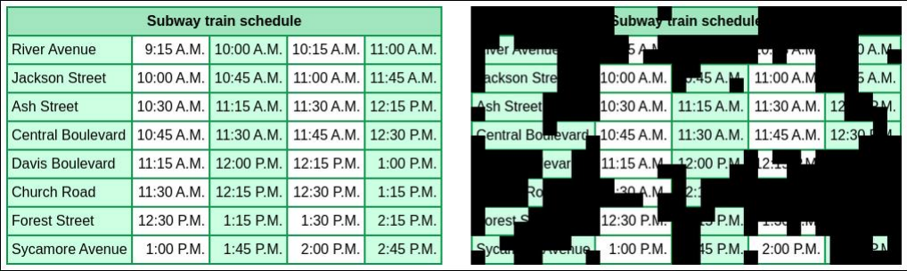
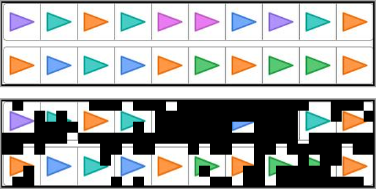
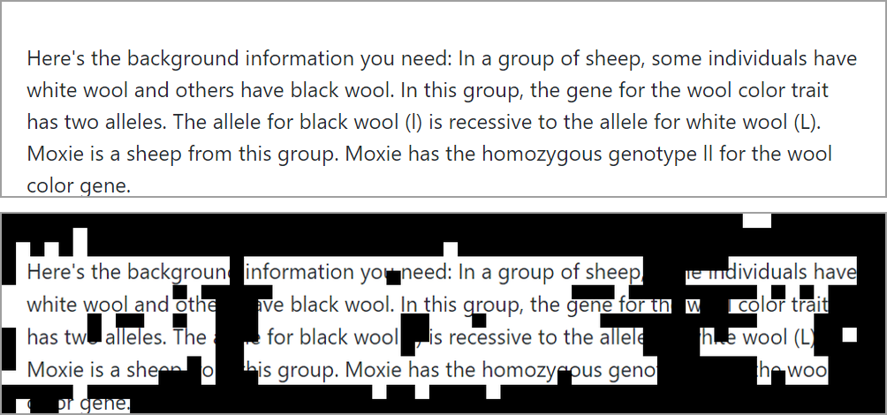

<div align="center">

# Grounding Multimodal Reasoning with Evidence-Ablated Negatives

[](https://neurips.cc/Conferences/2026)
[](#-models)
[](LICENSE)
[](https://www.python.org/)
[](https://github.com/volcengine/verl)

**Chenxi Liu, Tianyi Xiong, Yanshuo Chen, Heng Huang**

University of Maryland, College Park

<br>



<em>A clean image (left) and its evidence-ablated version (right).</em>

</div>

## 🔥 News

- **[2026/10]** We release the code and the [EVAN-3B](https://huggingface.co/DawnLiu/EVAN-3B), [EVAN-7B](https://huggingface.co/DawnLiu/EVAN-7B), and [EVAN-8B](https://huggingface.co/DawnLiu/EVAN-8B) checkpoints.

## 💡 Overview

RLVR rewards typically check only the final answer, not whether it came from the image or from language priors and dataset shortcuts. Models can thus learn to underuse visual evidence. Suppressing these shortcuts requires negatives that are plausible to the model yet expose them. **EVAN** (**EV**idence-**A**blated **N**egatives) masks the visual evidence a question needs, lets the current policy answer without it, and penalizes plausible wrong answers under the clean image:

1. **Visually dependent data.** Each question is scored by *scaled image information gain* (sIIG), the relative drop in response likelihood when the image is replaced by a blank one. RankMix selects high-sIIG questions to ablate, preserving category diversity.
2. **Evidence-ablated images.** Blacking out the patches with the largest absolute sIIG gradient removes query-critical evidence. Without it, the model more often falls back on language priors.
3. **Stable negative optimization.** During DAPO training, the policy also answers each selected question on its ablated image. A wrong answer that stays plausible under the clean image joins the clean rollout group. It is penalized under the **clean** image, where the evidence is visible, with a bounded negative advantage.

<details>
<summary><b>More examples of evidence-ablated images</b></summary>
<br>
<p align="center">
  
  <br>
  <em>Counting question. Top: clean image. Bottom: evidence-ablated image.</em>
</p>
<p align="center">
  
  <br>
  <em>Genetics question. Top: clean image. Bottom: evidence-ablated image.</em>
</p>
</details>

## 📊 Results

Accuracy (%) with sampling at temperature 1.0, from Table 1 of the paper. EVAN uses the same data and training recipe as the DAPO baseline.

| Model | Geo3K | MathVista | MathVerse | We-Math | DynaMath | MathVision | MMK12 | MMMU-Pro | LogicVista | Avg. |
| :--- | :-: | :-: | :-: | :-: | :-: | :-: | :-: | :-: | :-: | :-: |
| Qwen2.5-VL-3B | 19.4 | 46.3 | 33.5 | 29.9 | 40.4 | 18.2 | 36.3 | 19.8 | 32.1 | 30.7 |
| + DAPO | 38.8 | 62.4 | 60.4 | 60.5 | 59.3 | 26.5 | **72.2** | 29.9 | 43.0 | 50.3 |
| **+ EVAN** | **39.9** | **62.7** | **62.8** | **64.6** | **60.6** | **27.6** | 71.5 | **31.0** | **43.3** | **51.6** |
| Qwen2.5-VL-7B | 36.1 | 63.9 | 38.6 | 46.6 | 56.1 | 18.6 | 43.4 | 25.9 | 42.8 | 41.3 |
| + DAPO | 45.5 | 66.2 | **69.2** | 68.4 | 65.8 | 29.0 | 81.9 | 37.0 | 45.8 | 56.5 |
| **+ EVAN** | **46.0** | **69.0** | 69.1 | **69.7** | **66.5** | **31.3** | **82.2** | **38.8** | **48.8** | **57.9** |
| Qwen3-VL-8B | 65.2 | 68.7 | 69.4 | 77.2 | 73.4 | 38.0 | 69.1 | 40.3 | 61.3 | 62.5 |
| + DAPO | 74.6 | 71.9 | 84.0 | 83.9 | 76.9 | 56.7 | 84.1 | **52.3** | 62.4 | 71.9 |
| **+ EVAN** | **76.6** | **74.9** | **85.0** | **84.9** | **77.6** | **57.0** | **85.0** | 52.0 | **63.6** | **73.0** |

EVAN also has the best average at each scale among the open-source reasoning LMMs we compare with (e.g. VPPO-7B 57.0, VPPO-8B 71.2). See the paper for all baselines and ablations.

## 🤗 Models

| Model | Base model | License |
| :- | :- | :- |
| [🤗 EVAN-3B](https://huggingface.co/DawnLiu/EVAN-3B) | [Qwen2.5-VL-3B-Instruct](https://huggingface.co/Qwen/Qwen2.5-VL-3B-Instruct) | Qwen Research License (non-commercial) |
| [🤗 EVAN-7B](https://huggingface.co/DawnLiu/EVAN-7B) | [Qwen2.5-VL-7B-Instruct](https://huggingface.co/Qwen/Qwen2.5-VL-7B-Instruct) | Apache 2.0 |
| [🤗 EVAN-8B](https://huggingface.co/DawnLiu/EVAN-8B) | [Qwen3-VL-8B-Instruct](https://huggingface.co/Qwen/Qwen3-VL-8B-Instruct) | Apache 2.0 |

## 🔧 Installation

```bash
git clone https://github.com/DawnLIU35/EVAN.git
cd EVAN
conda create -n evan python=3.12 -y
conda activate evan
pip install -r requirements.txt
pip install https://github.com/Dao-AILab/flash-attention/releases/download/v2.8.1/flash_attn-2.8.1+cu12torch2.8cxx11abiFALSE-cp312-cp312-linux_x86_64.whl
pip install -e .
```

The code is built on [verl](https://github.com/volcengine/verl). The `verl/` folder is the verl 0.7.0.dev snapshot we trained with, plus small patches for image resizing and Qwen3-VL.

## 📦 Data

```bash
bash scripts/prepare_data.sh
```

This builds `data/virl39k/virl39k_evan.json` (training) and `data/mmk12/mmk12_test.json` (validation, used only for monitoring). The steps are:

| Step | Script | What it does |
| :- | :- | :- |
| 1 | `prepare_virl39k.py`, `prepare_mmk12.py` | Download [ViRL39K](https://huggingface.co/datasets/TIGER-Lab/ViRL39K) and the [MMK12 test split](https://huggingface.co/datasets/PAPOGalaxy/PAPO_MMK12_test). |
| 2 | `sample_responses.py` | Sample `--n` responses per question with Qwen3-VL-8B-Instruct. |
| 3 | `score_siig.py` | Score each question by sIIG (below), averaged over its responses. |
| 4 | `select_rankmix.py` | Select the top `--percent` percent of questions with RankMix. |
| 5 | `sample_responses.py --until-correct` | Resample (`--n` per round, up to `--max-rounds` rounds) until each selected question has a verified correct response. Questions without one get no ablated image. |
| 6 | `mask_evidence.py` | Black out the top `--mask-ratio` fraction of patches by sIIG-gradient magnitude and attach the images as `adv_image`. |

$$\mathrm{sIIG}(o) = \frac{\ell(o \mid q, I) - \ell(o \mid q, \varnothing)}{-\ell(o \mid q, \varnothing) + \eta}$$

where $\ell$ is the log-likelihood of response $o$ to question $q$, $\varnothing$ is a blank image, and $\eta$ is a small constant.

<details>
<summary><b>Data format</b></summary>
<br>

Each training row uses the verl format, with one `<image>` placeholder per image. Image paths are relative to the JSON file, and `adv_image` only appears on the selected questions:

```json
{
  "prompt": [{"role": "user", "content": "<image>\nIs the dotted line a line of symmetry?\nChoices:\n(A) yes\n(B) no"}],
  "images": ["images/Processed-0430e208-5f96-4dbd-8494-81869822c345-0.jpg"],
  "adv_image": ["ablated/Processed-0430e208-5f96-4dbd-8494-81869822c345-0.png"],
  "reward_model": {"ground_truth": "A"},
  "data_source": "virl39k",
  "extra_info": {"qid": "Processed-0430e208-5f96-4dbd-8494-81869822c345", "category": "(GradeSchool) Geometric", "source": "Processed"}
}
```

</details>

## 🚀 Training

```bash
bash scripts/train_qwen2_5_vl_3b.sh
bash scripts/train_qwen2_5_vl_7b.sh
bash scripts/train_qwen3_vl_8b.sh
```

> [!NOTE]
> The scripts run on 4 GPUs and log to Weights & Biases, so run `wandb login` first.

Shared settings are in [`evan/config/evan_trainer.yaml`](evan/config/evan_trainer.yaml) on top of verl's defaults, and per-model settings are in the scripts.

Checkpoints are saved to `checkpoints/evan/<experiment_name>`. To convert one to a Hugging Face model:

```bash
python -m verl.model_merger merge --backend fsdp \
    --local_dir checkpoints/evan/evan-qwen2.5-vl-3b/global_step_300/actor \
    --target_dir checkpoints/evan-qwen2.5-vl-3b
```

We evaluate with the [PAPO-Eval](https://github.com/xhguo7/PAPO-Eval) protocol: exact-match accuracy with sampling at temperature 1.0.

## 📂 Code Structure

```
evan/
├── main.py         # entry point (python -m evan.main)
├── trainer.py      # DAPO loop + evidence-ablated rollouts, filtering, and bounded negative advantages
├── actor.py        # actor update with the appended negatives
├── dataset.py      # training data with evidence-ablated images
├── reward.py       # 0.9 · accuracy + 0.1 · format
└── config/evan_trainer.yaml
preprocess/         # sIIG scoring, RankMix selection, and evidence ablation
scripts/            # data preparation and training scripts
verl/               # verl
```

## 🙏 Acknowledgements

We build on [verl](https://github.com/volcengine/verl) and train on [ViRL39K](https://huggingface.co/datasets/TIGER-Lab/ViRL39K). The prompt template and the MMK12 validation split follow [PAPO](https://github.com/MikeWangWZHL/PAPO).
